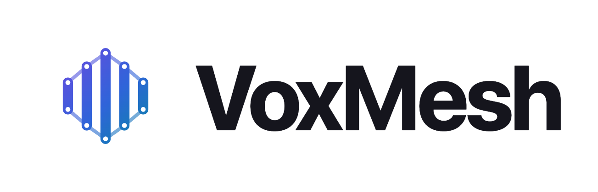
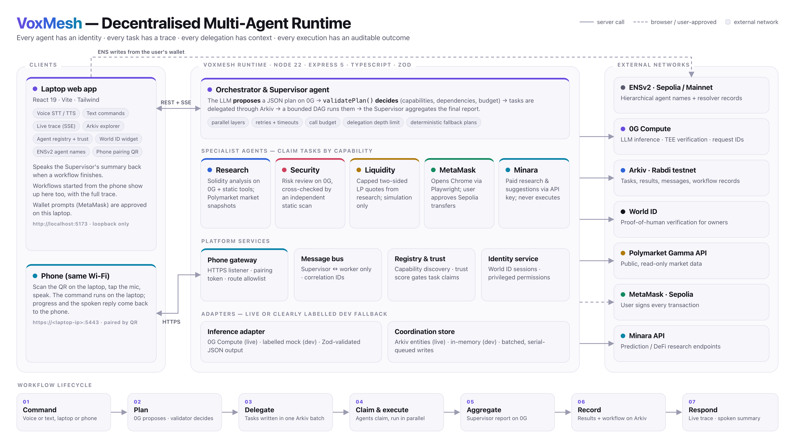

<p align="center">
  <picture>
    <source media="(prefers-color-scheme: dark)" srcset="docs/brand/voxmesh-logo-on-dark.png">
    
  </picture>
</p>

<p align="center"><b>A voice-driven, decentralised multi-agent runtime.</b><br>
Speak a task, and accountable AI agents plan it, do it and prove it.</p>

<p align="center"><i>Built at ETHGlobal Mumbai 2026.</i></p>

---

## What it does

You say or type a command, on your laptop or your paired phone. A **Supervisor** agent plans the work using **0G** inference and delegates tasks to specialist agents through **Arkiv**. The agents claim those tasks, run them and save their results back to Arkiv. The Supervisor combines everything into one report and reads it aloud.

- **Auditable by design.** Every task, claim, result and message is an Arkiv entity with an owner and an expiry. Anyone can re-query the trace.
- **The LLM proposes; code decides.** Plans are validated deterministically, tools are allowlisted, and budgets, timeouts and retries are enforced.
- **Agents with identities.** ENSv2 names per agent, World ID-verified owners, and a trust score that gates task claims.
- **Humans approve money.** Wallet actions open MetaMask, and the user approves or rejects each transaction.

**Agents:** Supervisor · Research (Solidity analysis, Polymarket data) · Security (risk review cross-checked by a static scan) · Liquidity (capped LP quote simulation) · MetaMask (Sepolia transfers) · Minara (paid research and suggestions).

<picture>
  <source media="(prefers-color-scheme: dark)" srcset="docs/architecture/voxmesh-architecture-dark.png">
  
</picture>

More detail: [ARCHITECTURE.md](ARCHITECTURE.md) · [API reference](docs/API.md) · [testing](docs/TESTING.md)

## Arkiv

Arkiv is VoxMesh's shared coordination memory on the **Rabdi testnet**, accessed through `@arkiv-network/sdk`:

- Agents **discover** open tasks with filtered queries.
- They **claim** tasks by patching them.
- Dependent agents **read upstream results** from Arkiv before they run.
- The Explorer and Trace pages render live Arkiv queries.

| | |
|---|---|
| **Writer wallet** | [`0x5c553e27e588b9dE72A76d521b17610A97d45143`](https://rabdi.explorer.arkiv.network/address/0x5c553e27e588b9dE72A76d521b17610A97d45143) |
| **Workspace** | `voxmesh-ethglobal-mumbai` |
| **Entities** | `voxmesh.agent.v1`, `voxmesh.task.v1`, `voxmesh.message.v1`, `voxmesh.execution.v1`, `voxmesh.workflow.v1`, `voxmesh.identity.v1` |

**Run a query** (read-only; no key or `.env` needed):

```bash
npm install
```

```bash
npm run arkiv:query
```

It runs this query and prints the latest workflow records with their keys, expiry blocks and status:

```ts
client.select({ $key: true, $expiresAt: true, $attributes: true, payload: true })
  .where(and(eq("workspace", "voxmesh-ethglobal-mumbai"), eq("arkiv.schema", "voxmesh.workflow.v1")))
  .ownedBy("0x5c553e27e588b9dE72A76d521b17610A97d45143")
  .limit(10)
  .fetch()
```

Add `-- task open`, `-- execution`, `-- message`, `-- agent` or `-- identity` to query other entity kinds.

| Judging criterion | File |
|---|---|
| Schema: entities, query fields, owners, expiry | [arkiv/schema.md](arkiv/schema.md) |
| Arkiv feedback | [arkiv/friction.md](arkiv/friction.md) |
| Reach | [arkiv/reach.md](arkiv/reach.md) |
| Why Arkiv | [arkiv/why-arkiv.md](arkiv/why-arkiv.md) |
| How we use Arkiv | [arkiv/how-you-use-arkiv.md](arkiv/how-you-use-arkiv.md) |

## Other integrations

| | How VoxMesh uses it |
|---|---|
| **0G Compute** | All planning, analysis and report inference. Each call records `x_0g_trace.request_id`, provider, billing and TEE verification, shown in the trace and saved on Arkiv. |
| **World ID** | IDKit v4 proof-of-human. Required to register or own agents, and optionally to run workflows (`WORKFLOW_REQUIRES_HUMAN`). |
| **ENSv2** | Hierarchical agent names (`research.supervisor.voxmesh.<parent>.eth`) with per-agent resolver records, created from the user's wallet on the Agents page. |
| **MetaMask** | The MetaMask agent opens Chrome via Playwright and requests a Sepolia transfer. The user approves it in MetaMask. |
| **Polymarket** | Public Gamma API market data for the LP simulation (read-only; no orders). |
| **Minara** | Paid prediction, DeFi, swap and perp research via API key. Suggestions only; never executed. |

Without credentials, everything runs on clearly labelled fallbacks (`DEV MOCK` inference, `LOCAL STORE`). Nothing fake is presented as a real 0G call, Arkiv transaction or World ID verification.

## Quick start

Requires Node ≥ 22.10.

```bash
npm install
```

```bash
cp .env.example .env
```

```bash
npm run dev
```

Open http://localhost:5173. The API runs on `127.0.0.1:8787`, and the integrations panel shows which services are `LIVE`.

To go live, set these in `.env` and restart:

| Integration | Variables | Get them |
|---|---|---|
| 0G | `ZG_API_KEY` (optional `ZG_MODEL`) | [pc.0g.ai](https://pc.0g.ai/dashboard/api-keys) |
| Arkiv | `ARKIV_PRIVATE_KEY` (funded with tGLM), `ARKIV_ACCESS_KEY` | [faucet](https://hub.arkiv.network/faucet) · [access keys](https://hub.arkiv.network/access-keys) |
| World ID | `WORLD_APP_ID`, `WORLD_RP_ID`, `WORLD_RP_SIGNING_KEY` (`WORLD_ENVIRONMENT=staging` for the simulator) | [developer.world.org](https://developer.world.org) |
| MetaMask | `METAMASK_CDP_ENDPOINT=http://127.0.0.1:9222` | see [MetaMask transfers](#metamask-transfers) |
| Minara | `MINARA_API_KEY` | Minara Pro / Partner account |
| Phone | `PHONE_ACCESS_ENABLED=true` | see [Phone voice commands](#phone-voice-commands) |

## Using it

On the **Command** page, press the mic or type:

- `Start a multi-agent workflow. Ask the research agent to analyse this smart contract and ask the security agent to review the findings.` runs a full audit of the selected sample contract.
- `Run research and security review in parallel on this contract.` runs both agents at the same time.
- `Simulate a Polymarket liquidity plan for "Another S&P 500 Company buys Bitcoin by December 31, 2026"` runs research and capped LP quotes; it is a simulation only.
- `Send 0.001 Sepolia ETH to 0x…` opens MetaMask for your approval.
- `Minara defi: <question>` makes one paid Minara call.

Then open **Execution Trace** to see each step with its Arkiv entity key, transaction and 0G request ID, and use **Verify against coordination store** to re-read it from Arkiv. **Arkiv Explorer** lists every entity kind live.

### Phone voice commands

Set `PHONE_ACCESS_ENABLED=true` and restart. On the laptop, open **Command → Phone → Pair a phone**, then scan the QR code with a phone on the same Wi-Fi.

- The phone page is served over HTTPS (self-signed; accept the one-time warning) at `https://<laptop-ip>:5443/phone`. HTTPS is what lets the phone use speech recognition.
- Commands run on the laptop. Progress and the spoken reply come back to the phone.
- The phone can only start and poll workflows. MetaMask prompts still appear on the laptop.
- The main API and the UI listen only on `127.0.0.1`. **Reset** in the Phone panel unpairs every phone.

### MetaMask transfers

Start a separate Chrome profile with a local debugging port, install MetaMask in it with a Sepolia-only test wallet, and set `METAMASK_CDP_ENDPOINT=http://127.0.0.1:9222`:

```bash
open -na "Google Chrome" --args --remote-debugging-port=9222 --user-data-dir="$HOME/.voxmesh/metamask-chrome"
```

The agent switches MetaMask to Sepolia and requests the transfer. You approve or reject it in MetaMask. The agent never enters passwords, signs or retries. A returned hash means the transaction was submitted, not that it is confirmed.

## Scripts

| Script | Purpose |
|---|---|
| `npm run dev` | API (watch mode) + web UI |
| `npm test` | Unit, orchestrator, API and end-to-end tests (mocks) |
| `npm run typecheck` | Strict TypeScript for frontend and server |
| `npm run build` | Typecheck + production frontend build |
| `npm run arkiv:query` | Read-only query of VoxMesh entities on Arkiv |
| `npm run arkiv:check` | Arkiv connectivity and write round-trip (needs a funded key) |
| `npm run test:integration` | Live 0G and Arkiv tests (skipped without credentials) |

## Project layout

| Path | Contents |
|---|---|
| `server/agents/` | Supervisor and specialist agents |
| `server/runtime/` | Orchestrator, plan validator, message bus, registry, trust scoring |
| `server/adapters/` | 0G inference, Arkiv store, World ID identity (each with a labelled dev fallback) |
| `server/phone/` | Paired HTTPS phone listener and mobile page |
| `src/` | React UI: Dashboard, Command, Trace, Agents, Arkiv Explorer, Identity |
| `shared/schemas.ts` | Zod schemas shared by server and client |
| `arkiv/` | Arkiv judging write-ups |
| `docs/` | API reference, testing, architecture diagram, slides, logo |

## Limitations

- Contract analysis is static pattern matching plus LLM review of the supplied source. **It is not an audit.**
- All Arkiv entities are written by one runtime signer, so claims are exclusive only within one runtime.
- Each Arkiv write waits for a block (~2 s), which adds about 15 s to a live workflow.
- Task entities include the contract source being analysed, so don't paste private code while connected to the public testnet.
- Workflow state and identity sessions are kept in memory and reset on restart; the records on Arkiv persist.
- Voice input needs Chrome, Edge or Safari. Text input works everywhere.

## How we used AI

We used AI coding assistants, primarily **Claude Code**, throughout the project: for code across the server, agents and UI, for tests, for documentation (including this README and the `arkiv/` write-ups), and for the architecture diagram, slides and logo. The team directed the work, reviewed the changes and tested them. Inside the product, AI is used at runtime through **0G Compute** inference for planning, analysis and reports. Its output is always validated by deterministic code before use.

## License

[MIT](LICENSE)
